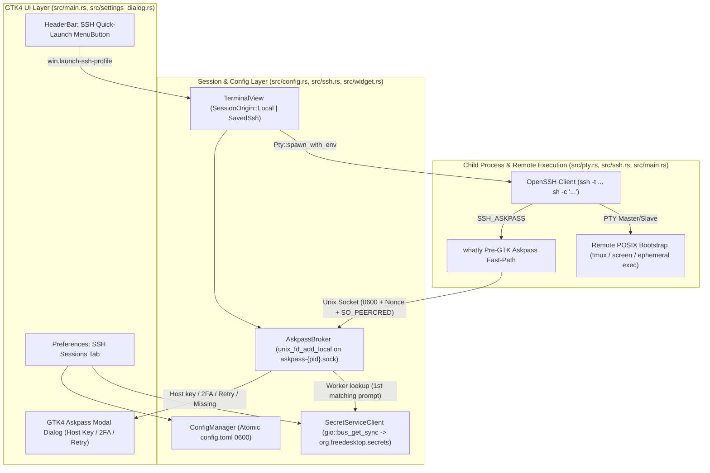

# Saved SSH Sessions and Remote Multiplexer Bootstrap

*   **Author:** Guilherme Fidelis da Silva
*   **Status:** Proposed
*   **Date:** 2026-11-17

--------------------------------------------------------------------------------

## Overview

WhattyTheShell! is a GTK4 GPU-accelerated terminal emulator written in Rust ([README.md](../../README.md)). Today, every terminal tab and split pane spawns a local login shell via `Pty::spawn_with_shell` ([src/pty.rs](../../src/pty.rs)). Users connecting to remote Linux or BSD servers must manually run `ssh` in each tab, re-enter passwords or passphrases when `ssh-agent` is absent, and manually discover or attach to remote `tmux` or `screen` sessions.

This design adds saved SSH profile management with OS keyring credential storage (`org.freedesktop.secrets`), OpenSSH `SSH_ASKPASS` IPC over a local Unix socket, automatic discovery of active remote `tmux` and `screen` sessions over a single `ssh -t` PTY connection, split/duplicate propagation, non-zero exit retention, and local working directory restoration upon application restart.

### Architecture & Execution Summary

*   **Approach**: Store non-secret profile metadata (`SshProfile`) in `$XDG_CONFIG_HOME/WhattyTheShell!/config.toml` ([src/config.rs](../../src/config.rs)) and optional secrets in `org.freedesktop.secrets` via `gtk4::gio::bus_get_sync`. Supply stored passwords/passphrases on demand via OpenSSH `SSH_ASKPASS` pointing to a pre-GTK fast-path in `whatty` backed by a `0600` Unix socket broker (`AskpassBroker`), falling back to a modal GTK4 dialog for host-key prompts (`yes/no`), 2FA/OTP codes, or retries. Launch SSH connections as a single `ssh -t` PTY process running a quote-free single-line POSIX `sh -c '...'` probe that offers active `tmux`/`screen` sessions before spawning a new session or ephemeral shell.
*   **Dependencies & Cost**: Zero new Cargo crates and zero new C shared libraries in `.deb`, `.rpm`, or AppImage packages (reuses `gtk4::gio`, `serde_json`, `libc`, and `async-channel` already in [Cargo.toml](../../Cargo.toml)), 1 `ssh -t` PTY process per SSH terminal pane (optionally sharing a TCP transport when `ControlMaster` is enabled), and an in-process Askpass fast-path that exits before initializing GTK4, `wgpu`, or `fontdb`.
*   **Phasing & Verification Gates**: Delivered across 4 incremental phases (`Config` schema & atomic save -> `src/ssh.rs` keyring/askpass/bootstrap & `main.rs` pre-GTK entrypoint -> `Pty` & `TerminalView` session lifecycle -> Preferences `SSH Sessions` UI, `HeaderBar` quick-launch, tab wiring & architecture docs), validated by:
    *   *Unit Verification*: `cargo test --bin WhattyTheShell` suite covering atomic `0600` config persistence, corrupt-config backup, OpenSSH flag validation/isolation, quote-free remote bootstrap script generation across `tmux`/`screen` orders, Askpass client/broker socket IPC classification, `Pty` env/exit handling, and `TerminalView` hold-open error state.
    *   *End-to-End Verification*: Manual verification against `localhost` with `org.freedesktop.secrets`, checking `config.toml` secret isolation, keyring attribute creation/deletion, quick-launch menu refresh and execution, GTK4 host-key/retry fallback dialog, interactive `tmux`/`screen` attachment, split/duplicate session propagation, non-zero exit banner hold-open, and disconnected local-shell restore upon restart.

## The Problem

Terminal users connecting to remote hosts encounter four limitations in WhattyTheShell! v0.4.3:

1.  **No Saved SSH Profiles or OS Keyring Integration**: WhattyTheShell! has no registry for recurring SSH hosts and no integration with `org.freedesktop.secrets`. Users authenticating with passwords or passphrase-protected keys without a persistent `ssh-agent` must re-enter secrets per tab/split or rely on insecure shell workarounds.
2.  **Ephemeral Remote Shells by Default**: Launching `ssh` starts an ephemeral login shell. Network drops or window closures forfeit running terminal state unless users remember to list and re-attach active `tmux` or `screen` sessions after every login.
3.  **Broken Split, Duplicate, and Title Semantics for Remote Sessions**: [src/widget.rs](../../src/widget.rs) and [src/main.rs](../../src/main.rs) assume every pane runs a local shell whose state maps to `/proc/<fg_pgrp>/cwd` ([src/pty.rs](../../src/pty.rs)). For an `ssh` process, `/proc/<fg_pgrp>/cwd` resolves to the local client directory, causing the 200ms title timer to overwrite the tab title with the client's local working directory (e.g., `~`) and causing splits (`Ctrl+Shift+E` / `Ctrl+Shift+O`) and tab duplication to open local shells instead of remote connections.
4.  **Lost SSH Diagnostics on Fast Exit**: When a PTY closes, `TerminalView` emits `"child-exited"` and `main.rs` destroys the pane or tab immediately. Non-zero `ssh` failures (DNS errors, refused connections, host-key mismatches, authentication failures) close the pane before OpenSSH error text can be read.

## Goals

*   **Saved SSH Profile Management**: Provide an `SSH Sessions` tab in Preferences ([src/settings_dialog.rs](../../src/settings_dialog.rs)) to create, edit, and delete Saved SSH Profiles (including `tmux` / `screen` priority selection) persisted in `$XDG_CONFIG_HOME/WhattyTheShell!/config.toml` ([src/config.rs](../../src/config.rs)), plus a quick-launch `MenuButton` in the main window `HeaderBar` ([src/main.rs](../../src/main.rs)).
*   **OS Keyring Credential Isolation**: Store optional SSH passwords and key passphrases exclusively in `org.freedesktop.secrets` keyed by immutable profile UUID, and deliver them to OpenSSH through `whatty`'s pre-GTK `SSH_ASKPASS` mode over a `0600` Unix domain socket, using a GTK4 modal dialog for host-key verification (`yes/no`), 2FA/OTP codes, or credential retries.
*   **Single-Connection `tmux` and `screen` Discovery**: Launch Saved SSH Sessions via a single `ssh -t` PTY process executing a portable POSIX `sh -c '...'` script that probes `tmux` and `screen` in configured priority order (`tmux -> screen` or `screen -> tmux`) and lets the user attach to an active session, start a new multiplexed session, or open an ephemeral remote shell.
*   **Profile-Aware Split and Duplicate Lifecycle**: Track `SessionOrigin` (`Local` vs. `SavedSsh { profile_id, profile_name, pre_ssh_local_dir }`) on every `TerminalView` so splitting or duplicating a Saved SSH Session opens a new `ssh -t` connection for the same profile (displaying the remote session selector), while manual `ssh` commands run inside local shells keep existing local CWD behavior.
*   **Local Directory Restoration on Application Restart**: Restore previously connected Saved SSH Tabs as disconnected local shells in the local working directory they occupied before launching SSH (`pre_ssh_local_dir`, falling back to `$HOME`).
*   **Hold-Open Error Visibility**: Keep failed `SavedSsh` panes open on non-zero `ssh` exit codes with an inline red diagnostic banner so scrollback and error details stay visible until the user presses `Enter` (`Return` / `KP_Enter`) or closes the pane/tab.

## Non-Goals

*   **Additional Terminal Multiplexers**: Supporting multiplexers beyond `tmux` and `screen` (such as `zellij`, `byobu`, `abduco`, or `dtach`).
*   **Insecure Credential Handling**: Storing plaintext passwords or passphrases in `config.toml`, scraping `"password:"` from the PTY output stream, or requiring external `sshpass` / `secret-tool` binaries.
*   **Automatic Startup Reconnect or Forced Mirroring**: Re-establishing live SSH connections automatically when WhattyTheShell! starts, or automatically attaching split panes into an already-open multiplexer session without user confirmation.
*   **Custom SSH Stack or GUI File/Tunnel Tools**: Replacing system OpenSSH (`ssh`) with an embedded Rust SSH implementation (`russh` / `libssh2`), or building an SFTP file manager or port-forwarding UI.

## Open Questions

*   None (see [concepts_brief.md](../../concepts_brief.md)).

## Critical User Journeys (CUJs)

### CUJ 1: Saving an SSH Profile with Keyring Password and Multiplexer Priority

*   **Given**: WhattyTheShell! is running with an active `org.freedesktop.secrets` service on the D-Bus session bus.
*   **When**: The user opens Preferences (`Ctrl+,`), selects `SSH Sessions`, fills in Name `"Prod API"`, Host `"10.0.1.50"`, User `"deploy"`, Port `2222`, selects Auth Type `PasswordKeyring`, enters a password, sets Multiplexer Priority to `tmux -> screen`, and clicks `Save Profile`.
*   **Then**: WhattyTheShell! generates an immutable UUID for the Saved SSH Profile, writes only non-secret fields atomically to `$XDG_CONFIG_HOME/WhattyTheShell!/config.toml` (`0600`), stores the password asynchronously in `org.freedesktop.secrets` with attributes `{"application": "io.github.whattytheshell", "profile_id": "<uuid>", "secret_kind": "password"}`, and populates `"Prod API"` dynamically when the `HeaderBar` quick-launch `MenuButton` opens.

### CUJ 2: Launching a Saved SSH Session and Attaching to an Active `tmux` or `screen` Session

*   **Given**: Profile `"Prod API"` is saved with `PasswordKeyring` credentials and priority `["tmux", "screen"]`, and remote host `10.0.1.50` has active `tmux` sessions `web` and `worker`.
*   **When**: The user opens the `HeaderBar` SSH quick-launch menu and selects `"Prod API"`.
*   **Then**: WhattyTheShell! creates a Saved SSH Tab with `SessionOrigin::SavedSsh`, spawns `ssh -t -o PubkeyAuthentication=no -o PreferredAuthentications=keyboard-interactive,password -p 2222 -- deploy@10.0.1.50 "sh -c '<single_line_script>'"`, answers OpenSSH's target password prompt automatically over the Askpass Unix socket without showing a dialog, lists `[1] tmux: web`, `[2] tmux: worker`, `[N] New multiplexed session (tmux)`, and `[E] Ephemeral shell`, and when the user enters `1`, runs `exec tmux attach-session -t "=web"`.

### CUJ 3: First-Time Host-Key Verification or 2FA Challenge via GTK4 Fallback Dialog

*   **Given**: Profile `"Staging Bastion"` is saved with `PasswordKeyring` credentials, and either the host key is absent from `~/.ssh/known_hosts` or the server requests a 2FA OTP token.
*   **When**: OpenSSH invokes `$SSH_ASKPASS` with `"Are you sure you want to continue connecting (yes/no/[fingerprint])?"` or `"Verification code:"`.
*   **Then**: `AskpassBroker` classifies the prompt as non-password/retry (Case 2), opens a modal GTK4 dialog displaying the exact OpenSSH prompt, sends `{"ok": true, "secret": "yes"}` (or the OTP string) back to the askpass client process, and lets OpenSSH proceed cleanly without leaking the stored password.

### CUJ 4: Splitting a Saved SSH Tab vs. Restarting the Application

*   **Given**: The user is running `"Prod API"` in a Saved SSH Tab launched from local directory `/home/user/projects`.
*   **When**: The user presses `Ctrl+Shift+E` (`win.split-right`), and later closes and restarts WhattyTheShell!.
*   **Then**: `Ctrl+Shift+E` spawns a right-hand pane carrying the same `SessionOrigin::SavedSsh` (`profile_id`, `pre_ssh_local_dir`) and displays the remote multiplexer selector on `10.0.1.50`. On application restart, WhattyTheShell! opens a disconnected local shell in `/home/user/projects`.

## Technical Plan (Architecture)

### 1. System Architecture & Component Boundaries (`src/ssh.rs`, `src/config.rs`, `src/pty.rs`, `src/widget.rs`, `src/settings_dialog.rs`, `src/main.rs`)

The feature adds a self-contained [src/ssh.rs](../../src/ssh.rs) module and extends [src/config.rs](../../src/config.rs), [src/pty.rs](../../src/pty.rs), [src/widget.rs](../../src/widget.rs), [src/settings_dialog.rs](../../src/settings_dialog.rs), and [src/main.rs](../../src/main.rs).



### 2. Data Model & Atomic Configuration Persistence (`src/config.rs`)

[src/config.rs](../../src/config.rs) defines `MultiplexerKind`, `SshAuthKind`, `SshProfile`, and `default_multiplexer_order`, and extends `Config` and `ConfigManager`:

```rust
#[derive(Debug, Clone, Copy, PartialEq, Eq, Serialize, Deserialize)]
#[serde(rename_all = "lowercase")]
pub enum MultiplexerKind {
    Tmux,
    Screen,
    #[serde(other)]
    Unknown,
}

pub fn default_multiplexer_order() -> Vec<MultiplexerKind> {
    vec![MultiplexerKind::Tmux, MultiplexerKind::Screen]
}

#[derive(Debug, Clone, Copy, PartialEq, Eq, Serialize, Deserialize, Default)]
#[serde(rename_all = "snake_case")]
pub enum SshAuthKind {
    #[default]
    AgentOrDefault,
    PasswordKeyring,
    IdentityFile,
}

#[derive(Debug, Clone, PartialEq, Eq, Serialize, Deserialize)]
pub struct SshProfile {
    pub id: String,
    pub name: String,
    pub host: String,
    #[serde(default)]
    pub user: Option<String>,
    #[serde(default)]
    pub port: Option<u16>,
    #[serde(default)]
    pub auth_kind: SshAuthKind,
    #[serde(default)]
    pub identity_file: Option<PathBuf>,
    #[serde(default = "default_multiplexer_order")]
    pub multiplexer_priority: Vec<MultiplexerKind>,
    #[serde(default)]
    pub bypass_multiplexer_probe: bool,
    #[serde(default)]
    pub use_control_master: bool,
}
```

*   **`Config` extension & UUIDs**: Adds `#[serde(default)] pub ssh_profiles: Vec<SshProfile>` to `Config`. Profile IDs are generated via `gtk4::glib::uuid_string_random().to_string()`. `use_control_master` defaults to `false` so existing `~/.ssh/config` `ControlMaster` directives remain untouched unless explicitly opted in per profile. `SavedTab` retains `{ title, working_dir, custom_title }`.
*   **Path Injection, Permissions, & Corrupt Recovery**:
    *   `ConfigManager::load_or_default_in(dir: &Path) -> Self` (called by `ConfigManager::load_or_default()`) ensures the config directory exists and always enforces mode `0700` via `PermissionsExt::from_mode(0o700)`.
    *   Reads `config.toml` as raw bytes via `std::fs::read`. If non-empty bytes fail UTF-8 decoding or `toml::from_str`, `load_or_default_in` writes a backup to `config.toml.corrupt.<unix_ts>-<pid>` with `OpenOptionsExt::mode(0o600)`, logs the error to `stderr`, falls back to `Config::default()`, and sets `corrupt_backup_pending = true`.
    *   `ConfigManager::save()` opens `config.toml.tmp` directly with `OpenOptionsExt::mode(0o600)` at creation time (`O_CREAT`), writes TOML, calls `File::sync_all()`, atomically renames `config.toml.tmp` over `config.toml`, and clears `corrupt_backup_pending`. Background session auto-saves (`set_open_tabs` / `set_active_tab_index`) skip writing while `corrupt_backup_pending` is `true` until an explicit user save (`save_user_config()`).

### 3. OS Keyring Integration via `gtk4::gio::bus_get_sync` (`src/ssh.rs`)

To keep zero new Cargo/C dependencies in [Cargo.toml](../../Cargo.toml) and packaging scripts (`scripts/build-*.sh`), `SecretServiceClient` communicates with `org.freedesktop.secrets` over `gtk4::gio::bus_get_sync(gtk4::gio::BusType::Session, None::<&gtk4::gio::Cancellable>)` on worker threads (`std::thread::spawn` + `async_channel` + `glib::spawn_future_local`, matching [src/settings_dialog.rs](../../src/settings_dialog.rs)):

*   **Lookup Attributes**: Every item uses `{"application": "io.github.whattytheshell", "profile_id": "<SshProfile.id>", "secret_kind": "<kind>"}` (`"password"` for `PasswordKeyring`, `"passphrase"` for `IdentityFile`), item label `"WhattyTheShell! SSH (<profile.name>)"`, and content type `"text/plain; charset=utf-8"`.
*   **Client API**:
    *   `SecretServiceClient::lookup_secret_sync(profile_id: &str, secret_kind: &str) -> Result<Option<String>, String>`
    *   `SecretServiceClient::store_secret_async(profile_id: String, label: String, secret_kind: String, secret: String, on_done: Box<dyn FnOnce(Result<(), String>) + 'static>)` (or `async_channel::Sender<Result<(), String>>`)
    *   `SecretServiceClient::delete_secret_async(profile_id: String, secret_kind: Option<String>, tx: async_channel::Sender<Result<(), String>>)`
*   **Locked Collection & Signal Loop Protocol**:
    1. Call `org.freedesktop.Secret.Service.OpenSession("plain", Variant(""))` -> `(output, session_path)`. Ensure `org.freedesktop.Secret.Session.Close()` is invoked on drop/return (best effort).
    2. For prompts returned by `Unlock`, `Collection.CreateItem`, or `Item.Delete` when `prompt_path != "/"`: push a per-thread `let ctx = glib::MainContext::new()` via `ctx.with_thread_default(...)`, create a `glib::MainLoop::new(Some(&ctx), false)`, subscribe to `org.freedesktop.Secret.Prompt::Completed` **before** calling `Prompt.Prompt("")`, add a `60 s` timeout source on `ctx`, run `main_loop.run()`, and return `Err("keyring unlock dismissed")` if `dismissed == true` or timed out.
    3. On `lookup_secret_sync`: call `SearchItems(attributes)`; unlock any `locked_paths` via Step 2; call `GetSecrets` with the first unlocked item path and decode UTF-8 bytes cleanly.
    4. On save (`store_secret_async`): ensure `/org/freedesktop/secrets/aliases/default` is unlocked if needed, then call `Collection.CreateItem(properties, secret_tuple, true)` (`Label` + `Attributes`, `secret_tuple = (session_path, &[], secret.as_bytes(), "text/plain; charset=utf-8")`), awaiting any returned prompt path.
    5. On deletion or `auth_kind` switch to `AgentOrDefault`: search matching profile items (matching both `"password"` and `"passphrase"` when `secret_kind` is `None`) and delete via `Item.Delete`, awaiting any returned prompt path.
    6. If `org.freedesktop.secrets` is unavailable (`ServiceUnknown` / `NameHasNoOwner`), `store_secret_async` surfaces the error in Preferences, and `lookup_secret_sync` returns `Err(...)` so `AskpassBroker` falls back cleanly to the GTK4 modal dialog.

### 4. Headless `SSH_ASKPASS` Fast-Path & Main-Loop Socket Broker (`src/main.rs`, `src/ssh.rs`)

1.  **Pre-GTK Entrypoint (`src/main.rs` & `src/ssh.rs`)**:
    *   At line 1 of `fn main()`, prior to `Application::builder()`:
        `if std::env::args().any(|a| a == "--ssh-askpass") || (std::env::var_os("WHATTY_SSH_ASKPASS_SOCKET").is_some() && std::env::var_os("WHATTY_SSH_ASKPASS_NONCE").is_some() && std::env::args().len() >= 2) { ssh::run_askpass_client_and_exit(); }`
    *   `run_askpass_client_and_exit()` reads `WHATTY_SSH_ASKPASS_SOCKET`, `WHATTY_SSH_ASKPASS_NONCE`, `SSH_ASKPASS_PROMPT` (empty if unset), and extracts the prompt string via `std::env::args().skip(1).find(|a| a != "--ssh-askpass").unwrap_or_default()`.
    *   It connects to `$WHATTY_SSH_ASKPASS_SOCKET`, sends a single-line JSON object serialized with `serde_json` (`{"nonce": "...", "prompt": "...", "prompt_hint": "..."}`), reads one JSON response line `{"ok": true, "secret": "..."}` (printing `<secret>\n` to stdout and exiting `0`) or `{"ok": false}` (exiting `1`), never initializing GTK4, `wgpu`, or `fontdb`.
    *   To avoid leaking askpass state into child shells or sub-invocations, `Pty::spawn_inner` clears `WHATTY_SSH_ASKPASS_SOCKET`, `WHATTY_SSH_ASKPASS_NONCE`, `SSH_ASKPASS`, and `SSH_ASKPASS_REQUIRE` via `cmd.env_remove(...)` before applying per-spawn `envs`.
2.  **In-Process `AskpassBroker` (`src/ssh.rs`)**:
    *   Constructed **once** as a process-wide `Clone` handle in `src/main.rs` (shared across any `ApplicationWindow` instances opened via GTK single-instance activation).
    *   `ssh_runtime_dir() -> io::Result<PathBuf>` resolves `$XDG_RUNTIME_DIR/whattytheshell`, falling back to `/tmp/whattytheshell-<uid>` (`uid = unsafe { libc::geteuid() }`), verifying via `std::fs::symlink_metadata()` that existing directories are real directories (`!meta.file_type().is_symlink()`), owned by `uid`, and mode `0700` (failing if hijacked). Unlinks any stale `askpass-<pid>.sock`, binds `UnixListener` at `askpass-<pid>.sock` with mode `0600`, sets non-blocking mode, and unlinks the socket on `Drop`.
    *   Drives accepted connections on the GTK main loop via `glib::unix_fd_add_local` (matching [src/widget.rs](../../src/widget.rs)), verifying peer UID with `SO_PEERCRED` (`uid == libc::geteuid()`), bounding reads to `4096` bytes with a `500 ms` `SO_RCVTIMEO`, and deserializing with `serde_json`.
    *   Only profiles with `auth_kind == PasswordKeyring` or `auth_kind == IdentityFile` register an attempt (`AskpassBroker::register_attempt(&self, window: &gtk4::ApplicationWindow, profile_id: String, profile_name: String, auth_kind: SshAuthKind) -> AskpassAttempt`) generating a 128-bit random hex `nonce` from 16 bytes read out of `/dev/urandom`. Nonces remain valid for multi-step prompts (e.g., passphrase + 2FA) during one connection until `Drop` on the attempt token (`revoke_attempt`) or `120 s` TTL expiration. Unknown/expired nonces immediately return `{"ok": false}`. Profiles with `auth_kind == AgentOrDefault` do **not** set `SSH_ASKPASS` or register nonces, letting OpenSSH use the live PTY `/dev/tty` directly.
    *   Prompt classification (`classify_prompt`):
        *   **Case 1 (Automated First-Attempt Lookup)**: `prompt_hint` is empty (not `"confirm"` and not `"none"`), `password_attempts == 0`, does not contain `"yes/no"` or `"fingerprint"`, and matches `auth_kind`: `"password"` for `PasswordKeyring` when prompt matches `*password*` (case-insensitive); `"passphrase"` for `IdentityFile` when prompt matches `*passphrase*`. Increments `password_attempts = 1` and spawns a worker thread (`std::thread::spawn` + `async_channel` + `glib::spawn_future_local`) to call `SecretServiceClient::lookup_secret_sync(profile_id, kind)` (keeping `org.freedesktop.secrets` I/O off the GTK main loop). If `Ok(Some(secret))`, replies `{"ok": true, "secret": secret}` over the accepted `UnixStream`; otherwise falls through to Case 2.
        *   **Case 2 (GTK4 Modal Fallback Dialog)**: Presented directly on the GTK main thread transient to the originating `ApplicationWindow` (canceling cleanly if the window was closed):
            *   If `prompt_hint == "confirm"` or prompt contains `"yes/no"`: displays the prompt text with `Reject` (`{"ok": false}`) and `Accept` (`{"ok": true, "secret": "yes"}`), plus a text entry if `[fingerprint]` is requested (`{"ok": true, "secret": "<entered>"}`).
            *   If `prompt_hint == "none"`: displays an informational message dialog with an `OK` button returning `{"ok": true, "secret": ""}`.
            *   Otherwise (2FA/OTP, missing secret, or retry `password_attempts >= 1`): displays the exact `prompt` text with a masked `gtk4::PasswordEntry`, returning `{"ok": true, "secret": "<entered>"}` on submit or `{"ok": false}` on cancel. (Credential updates remain in Preferences so transient handshakes never mutate the keyring.)

### 5. `ssh -t` Command Assembly & Remote POSIX Bootstrap (`src/ssh.rs`, `src/pty.rs`)

1.  **Command Validation, Option Scoping, & Environment (`src/ssh.rs`)**:
    *   Validates `profile.host` (non-empty, must not start with `-`, must not contain ASCII whitespace, control chars, or NUL, and must not contain `@` when `profile.user` is `Some`), `profile.user` (if `Some`, non-empty, must not start with `-`, no whitespace/control/NUL/`@`), and `profile.port` (if `Some(p)`, `p >= 1`).
    *   Constructs `ssh` arguments:
        *   `-t` (always allocate remote PTY).
        *   Auth isolation per `profile.auth_kind` (prevents OpenSSH from prompting for unrelated local keys before target auth):
            *   `PasswordKeyring`: `-o PubkeyAuthentication=no -o PreferredAuthentications=keyboard-interactive,password`
            *   `IdentityFile`: `-o IdentitiesOnly=yes`, plus `-i <expanded_path>` if `profile.identity_file` is `Some` non-empty (expanding leading `~/`)
            *   `AgentOrDefault`: optional `-i <expanded_path>` if `profile.identity_file` is `Some` non-empty.
        *   If `profile.use_control_master` is `true`, resolves `let cm_path = ssh_runtime_dir()?.join("cm-%C")`: when `cm_path.as_os_str().len() < 88` (leaving room under Linux's `108`-byte `sun_path` limit for OpenSSH's `.XXXXXXXXXXXXXXXX` atomic suffix), appends `-o ControlMaster=auto`, `-o ControlPath=<cm_path>`, `-o ControlPersist=60s`, `-o ServerAliveInterval=15`, `-o ServerAliveCountMax=3`.
        *   If `profile.port` is `Some(port)`: `-p <port>`.
        *   `--` (option terminator before destination).
        *   Destination: `<user>@<host>` or `<host>`.
        *   Remote command (omitted when `profile.bypass_multiplexer_probe` is `true`): `sh -c '<escaped_bootstrap_script>'`.
    *   Child environment (`envs`, applied only when `auth_kind` is `PasswordKeyring` or `IdentityFile`): `SSH_ASKPASS=<std::env::current_exe()>`, `SSH_ASKPASS_REQUIRE=force`, `WHATTY_SSH_ASKPASS_SOCKET=<socket_path>`, `WHATTY_SSH_ASKPASS_NONCE=<nonce>`, and `DISPLAY=<existing_or_:0>` (preserving existing non-empty `DISPLAY`).
2.  **Portable Single-Line POSIX Bootstrap Script (`src/ssh.rs`)**:
    *   Generated as a **single line containing zero internal single quotes `'`, zero backslashes `\`, and zero newlines `\n`** (`!script.contains('\'') && !script.contains('\\') && !script.contains('\n')`), making `sh -c '...'` parse identically under `sh`, `bash`, `zsh`, `dash`, `fish`, and `tcsh`.
    *   Extends `PATH="$PATH:/usr/local/bin:/opt/homebrew/bin:$HOME/.local/bin"`.
    *   Inspects `priority` (`MultiplexerKind::Tmux` / `MultiplexerKind::Screen`, skipping `Unknown` and falling back cleanly to `exec "${SHELL:-/bin/sh}" -l` if empty or neither tool is installed).
    *   Enumerates sessions cleanly:
        *   `tmux`: `tmux list-sessions -F "#{session_name}|#{session_windows} windows (#{?session_attached,attached,detached})" 2>/dev/null`
        *   `screen`: parses `LC_ALL=C screen -ls 2>/dev/null` filtering only live entries `(Attached)` / `(Detached)` / `(Multi, attached)` (explicitly excluding `(Dead` and `(Removed)` lines), ignoring non-zero `screen -ls` exit codes.
    *   Prints selector menu on `/dev/tty` and reads a full line (`IFS= read -r choice < /dev/tty || exit 0`):
        *   If active sessions `1..K` exist: empty `Enter` or `[1..K]` attaches (`exec tmux attach-session -t "=$sel"` or `exec screen -d -r "$sel"` using tab/newline/unit-safe line lookup via `awk`/`sed` so session names with spaces or leading dashes work cleanly); `[N]`/`[n]` prompts for optional session name (using native default `tmux new-session` / `screen` if blank, or `-s "$name"` / `-S "$name"` if given); `[E]`/`[e]` executes `exec "${SHELL:-/bin/sh}" -l`; invalid input re-prompts; `Ctrl+D` (`EOF`) exits `0`.
        *   If no active sessions exist: offers `[1] Start new <primary_mux> session (default)` and `[2] Start ephemeral shell without multiplexer` (empty `Enter` selects `[1]`).

### 6. `Pty`, `TerminalView`, and Tab Lifecycle Integration (`src/pty.rs`, `src/widget.rs`, `src/main.rs`)

*   **`Pty` Extensions ([src/pty.rs](../../src/pty.rs))**:
    *   `Pty::spawn_inner(..., login_shell: bool, extra_envs: &[(&str, &str)])` passes `-l` **only** when `login_shell == true` (`spawn_with_shell`), never for `spawn_with_env` (`ssh`). `spawn_inner` always removes inherited `WHATTY_SSH_ASKPASS_SOCKET`, `WHATTY_SSH_ASKPASS_NONCE`, `SSH_ASKPASS`, and `SSH_ASKPASS_REQUIRE` before applying `extra_envs`.
    *   Adds `pub fn spawn_with_env(program: &str, args: &[&str], cols: u16, rows: u16, working_dir: Option<&Path>, envs: &[(&str, &str)]) -> io::Result<Self>`.
    *   Adds `last_exit_code: Option<i32>` and `pub fn try_wait_exit_code(&mut self) -> Option<i32>` (caching `ExitStatus::code()` or `128 + signal` via `ExitStatusExt::signal()`).
    *   Updates `Pty::terminate(&mut self)`: if `self.last_exit_code.is_some()` (child already exited and reaped), skip `libc::kill(-pid, ...)` completely to prevent signaling a recycled OS PID. Otherwise, send `SIGHUP` to `-pid`, call non-blocking `try_wait()`, and if still running transfer `child` to a short detached thread (`std::thread::spawn`) that polls for `30 ms` (`2 ms` step) before `SIGKILL` + `wait()` so multi-tab close never stalls the GTK main loop.
*   **`SessionOrigin` & Hold-Open on Non-Zero Exit ([src/widget.rs](../../src/widget.rs))**:
    *   Defines `#[derive(Clone, Debug, PartialEq, Eq)] pub enum SessionOrigin { Local, SavedSsh { profile_id: String, profile_name: String, pre_ssh_local_dir: Option<PathBuf> } }`.
    *   Stores `session_origin: RefCell<SessionOrigin>`, `awaiting_error_dismiss: Cell<bool>`, and `_askpass_attempt: RefCell<Option<crate::ssh::AskpassAttempt>>` (revoking the nonce automatically on pane close/drop) inside `TerminalViewInner`.
    *   Refactors shared GTK/renderer/controller wiring into private `TerminalView::with_pty_and_origin(...)`, used by both `with_shell_and_working_dir` and `TerminalView::with_ssh_profile`.
    *   `TerminalView::current_working_dir(&self)` returns `pre_ssh_local_dir` directly whenever `session_origin()` is `SessionOrigin::SavedSsh`, keeping `win.new-tab`, tab-bar double-click, `copy_path_btn`, `restore_name_btn`, `close_tab_page`, and `window.connect_close_request` pointed at the client's local folder without querying remote `/proc/<ssh_pid>/cwd`.
    *   `TerminalView::auto_tab_title(&self) -> Option<(String, String)>` returns `(profile_name, format!("SSH: {profile_name}"))` for `SavedSsh` and `format_dir_path(cwd)` for `Local`, leaving `custom_title` strictly `None` unless explicitly renamed by the user.
    *   On PTY EOF (`exited == true`) in `unix_fd_add_local`: drops any held `AskpassAttempt` token, and for `SavedSsh` polls `pty.try_wait_exit_code()` up to 5 times at `2 ms` intervals if `None` (handling Linux `POLLHUP` vs zombie race). If exit status is non-zero (`Some(code)` with `code != 0`), writes `\r\n\x1b[1;31m[WhattyTheShell: SSH connection exited with code <code>. Press Enter to close.]\x1b[0m\r\n` to `Terminal::advance`, sets `awaiting_error_dismiss = true`, calls `widget.queue_draw()`, and returns `glib::ControlFlow::Break` without emitting `"child-exited"`. (For `Some(0)` or unresolved `None`, emits `"child-exited"`.)
    *   While `awaiting_error_dismiss` is `true`: `im_context.connect_commit` drops text instead of writing to the dead PTY; `key_controller.connect_key_pressed` preserves copy (`Ctrl+Shift+C`) and scrollback (`Shift+PageUp`/`PageDown`), handles `Return`/`KP_Enter` by clearing `awaiting_error_dismiss`, **dropping any `RefCell` borrow on `inner` before emitting `"child-exited"`** (avoiding `BorrowMutError` inside `close_pane_or_tab` -> `tv.terminate()`), and returns `glib::Propagation::Stop` on all consumed keys.
*   **Tab Lifecycle, Splits, & Restores ([src/main.rs](../../src/main.rs))**:
    *   Primary terminal lookup uses `crate::split::find_terminals(&page).first()`.
    *   200ms timer and `"Restaurar Nome Automático"` respect `view.custom_title()` first, otherwise display `view.auto_tab_title()`.
    *   `do_split` checks `split::can_split(&root)` (`MAX_PANES_PER_TAB = 4`) **before** constructing/spawning a new `TerminalView`; if the focused pane is `SavedSsh`, it looks up `profile_id` in `ConfigManager` (falling back to a `Local` shell in `pre_ssh_local_dir` if the profile was deleted in Preferences). `dup_btn` behaves symmetrically.
    *   `close_tab_page` and `window.connect_close_request` serialize `SavedTab` using `view.current_working_dir()` (`pre_ssh_local_dir`) and `custom_title: view.custom_title().is_some()` so restarting restores a disconnected local shell in `pre_ssh_local_dir` while preserving user-renamed titles.

## Risks & Mitigations

*   **OpenSSH Prompt Misrouting / Multi-Host Cross-Credential Leak**: Using `SSH_ASKPASS_REQUIRE=force` with naive substring matching can send a target password to a local private-key passphrase prompt or `ProxyJump` bastion. Mitigated by enforcing `-o PubkeyAuthentication=no -o PreferredAuthentications=keyboard-interactive,password` on `PasswordKeyring` profiles, `-o IdentitiesOnly=yes` on `IdentityFile` profiles, omitting `SSH_ASKPASS` for `AgentOrDefault`, strictly matching prompt kind against `auth_kind`, and limiting automated keyring delivery to `password_attempts == 0`.
*   **Non-POSIX Remote Shells & `~/.ssh/config` `RemoteCommand` Conflicts**: Remote `fish`, `tcsh`, `nu`, or `pwsh` fail on multiline `'...'` or `'\''` quoting, and host blocks with `RemoteCommand` reject CLI commands (`sh -c`). Mitigated by emitting a single-line quote-free/backslash-free `sh -c '...'` payload (verified by unit tests) and providing `bypass_multiplexer_probe` per profile.
*   **Linux `108`-Byte `sun_path` Limit & Stale Runtime Sockets After `SIGKILL`**: Exceeding `sockaddr_un.sun_path` (`108` bytes on Linux) breaks `AskpassBroker` bind and OpenSSH `ControlPath` creation, and `SIGKILL` skips `Drop` cleanup. Mitigated by falling back `/tmp/whattytheshell-<uid>` when `$XDG_RUNTIME_DIR` exceeds budget, clamping `ControlPath` to `< 88` bytes, verifying owner UID + non-symlink `0700` dirs via `symlink_metadata()`, enforcing `SO_PEERCRED`, and unlinking stale sockets before bind.
*   **Missing Keyring Daemon / Old OpenSSH (`< 8.4`) / Missing `ssh` Binary**: Minimal window managers without `org.freedesktop.secrets`, systems lacking `ssh` (`ENOENT`), or OpenSSH `< 8.4` (lacking `SSH_ASKPASS_REQUIRE`) change runtime behavior. Mitigated by surfacing clear Preferences errors, falling back to interactive modal/PTY prompts when D-Bus Secret Service fails, and reporting spawn errors inline on launch failure.
*   **PTY `POLLHUP` Teardown Race & Long-Lived Pane PID Reuse**: Linux PTY EOF can race `waitpid(WNOHANG)` on fast exits, and held-open failed panes keep the GTK widget alive long after the PID was reaped. Mitigated by bounded `2 ms × 5` EOF reap checks on `SavedSsh` panes and early exit in `Pty::terminate()` when `last_exit_code.is_some()`. *(Note: SSH forwards the last remote interactive shell exit code on exit, so a failing interactive command immediately before `Ctrl+D` displays the hold-open banner if non-zero.)*
*   **Large SSH Profile Lists in `HeaderBar` Menu**: Rendering many saved profiles directly in a flat popover can overflow viewport height. Mitigated by wrapping the `HeaderBar` popover list inside a `gtk4::ScrolledWindow` (`propagate_natural_height`, `max_content_height`) when profiles exceed ~12 entries.

## Non-Functional Requirements

*   **Security & Privacy**:
    *   Passwords and key passphrases are never persisted to `$XDG_CONFIG_HOME/WhattyTheShell!/config.toml`, passed via CLI arguments, or written to logs.
    *   `$XDG_CONFIG_HOME/WhattyTheShell!` is enforced at mode `0700`, `config.toml` and `.corrupt.*` backups are created with mode `0600`, and `WHATTY_SSH_ASKPASS_*` variables are scrubbed from child local shells.
    *   The Askpass Unix domain socket directory is verified (`0700`, owner UID, non-symlink), socket mode is `0600`, peer connections verify `SO_PEERCRED`, each connection requires a 128-bit CSPRNG nonce from `/dev/urandom`, and `ssh` always places `--` before the host after rejecting leading `-`, whitespace/NUL, and `@` conflicts.
*   **Latency, Responsiveness & UI Blocking**:
    *   Pre-GTK `SSH_ASKPASS` mode performs socket JSON IPC and exits before calling GTK4, `wgpu`, or `fontdb` initialization (avoiding GUI/GPU init cost; shares dynamic library mapping with the `whatty` binary).
    *   All `org.freedesktop.secrets` D-Bus calls execute on worker threads (`std::thread::spawn` + `async_channel` + `glib::spawn_future_local`) with per-worker `glib::MainLoop` timeouts, and `Pty::terminate` offloads `SIGKILL` escalation off the GTK main loop.
*   **Rollout & Rollback Compatibility**:
    *   New `Config` fields use `#[serde(default)]` and `MultiplexerKind` uses `#[serde(other)]`, allowing `v0.4.3` `config.toml` files to load with zero migration, while `SavedTab` format remains unchanged. *(Downgrade note: running `v0.4.3` afterward reads unknown keys cleanly, though any `ConfigManager::save()` on exit in `v0.4.3` omits `ssh_profiles`.)*

## Alternatives Considered

### Alternative A: Stateless Askpass with `-o StrictHostKeyChecking=accept-new` and `-o NumberOfPasswordPrompts=1`

*   **Pros**: Avoids building a Unix socket IPC channel and GTK4 fallback dialog while auto-accepting unseen host keys via OpenSSH options.
*   **Cons**: Cannot prompt interactively when a host requires a stored password plus a second-factor OTP challenge, and silently accepts unknown host keys instead of showing fingerprint verification.
*   **Trade-off Decision**: Selecting Unix socket IPC with a GTK4 fallback dialog keeps host-key fingerprint review explicit and supports 2FA/retry prompts alongside stored keyring secrets.

### Alternative B: External `sshpass` and `secret-tool` Subprocesses

*   **Pros**: Fewer lines of IPC code by shelling out to external CLI tools.
*   **Cons**: Adds runtime package dependencies in `scripts/build-deb.sh`, `scripts/build-rpm.sh`, and [Cargo.toml](../../Cargo.toml) metadata (or requires bundling into `scripts/build-appimage.sh`), and `sshpass` scrapes `"password:"` in the PTY stream rather than using OpenSSH's `SSH_ASKPASS` channel.
*   **Trade-off Decision**: Using `org.freedesktop.secrets` via GLib D-Bus plus OpenSSH `SSH_ASKPASS` avoids external binary packaging requirements and PTY stream scraping.

### Alternative C: Embedded Rust SSH Protocol Client (`russh` / `libssh2`)

*   **Pros**: Gives programmatic Rust callbacks for auth and channels without `ssh` or `SSH_ASKPASS`.
*   **Cons**: Loses native OpenSSH `~/.ssh/config` directives (`ProxyJump`, `Match`, `ControlMaster`, `IdentityAgent`), FIDO2 hardware keys, and Kerberos/GSSAPI, while adding compile time and crypto maintenance surface.
*   **Trade-off Decision**: Delegating transport to system `ssh` preserves full user OpenSSH configuration and hardware-key compatibility.

### Alternative D: Supporting 6 Multiplexers (`tmux`, `zellij`, `screen`, `byobu`, `abduco`, `dtach`)

*   **Pros**: Covers detach utilities (`abduco`, `dtach`), wrappers (`byobu`), and newer multiplexers (`zellij`).
*   **Cons**: `dtach` lacks a session listing registry, `byobu` aliases `tmux`/`screen` (duplicating entries), and `zellij list-sessions` formatting varies across releases and leaks ANSI styling.
*   **Trade-off Decision**: Restricting remote discovery to `tmux` and `screen` avoids brittle multi-version ANSI screen scraping while allowing deterministic per-profile priority ordering.

### Alternative E: Pre-Login Background SSH Probe Before Creating the GTK Tab

*   **Pros**: Renders the remote session picker in a native GTK4 dialog prior to opening the terminal tab.
*   **Cons**: Opens two SSH connections (one background probe for `tmux ls`/`screen -ls` plus a second PTY connection), doubling TCP/SSH handshake latency and prompting twice for OTP/un-cached keys when `ControlMaster` is off.
*   **Trade-off Decision**: Executing the selector directly inside a single `ssh -t` PTY process eliminates the duplicate SSH handshake, extra connection process, and repeated authentication prompt.

### Alternative F: Auto-Reconnecting SSH Tabs on Application Startup

*   **Pros**: Re-establishes active remote sessions immediately at launch.
*   **Cons**: Restoring multiple saved SSH tabs concurrently triggers parallel network timeouts when offline/off-VPN, simultaneous keyring unlock dialogs, and potential `MaxStartups` throttling.
*   **Trade-off Decision**: Restoring previously connected SSH tabs as disconnected local shells in `pre_ssh_local_dir` avoids offline startup stalls and authentication storms while returning users to their local working context.

### Alternative G: Auto-Attaching Split Panes to the Active Multiplexer Session

*   **Pros**: Omits the selector when splitting a remote pane.
*   **Cons**: Attaching two GTK panes to an identical `tmux` or `screen` session duplicates identical screen content across both panes and causes continuous `TIOCSWINSZ` resize contention.
*   **Trade-off Decision**: Showing the remote session selector per split/duplicate pane prevents shared-viewport resize fights and lets users pick a separate session, new session, or ephemeral shell cleanly.

### Alternative H: Adding `zbus` / `oo7` / `libsecret-1` Instead of `gtk4::gio` D-Bus

*   **Pros**: Provides high-level encrypted DH+AES Secret Service wrappers (`oo7` / `zbus`) or synchronous C APIs (`libsecret-1`).
*   **Cons**: `libsecret-1` adds a C runtime dependency across `.deb`/`.rpm`/AppImage targets, while `zbus`/`oo7` pull async executor dependency trees into `Cargo.toml`/`Cargo.lock`.
*   **Trade-off Decision**: Using `gtk4::gio::bus_get_sync` builds directly on GLib already linked by `gtk4` with zero new dependencies, keeping D-Bus session traffic scoped strictly to the local user bus.

--------------------------------------------------------------------------------

## Detailed Implementation Plan

### Implementation Phasing & Checkpoints

*   **Phase 1 (`Config` Schema & Atomic Persistence)**: Update [src/config.rs](../../src/config.rs) with `MultiplexerKind`, `SshAuthKind`, `SshProfile`, `default_multiplexer_order`, `load_or_default_in(&Path)`, and atomic `0600` `save()`. Verify with `cargo test --bin WhattyTheShell config::tests`.
*   **Phase 2 (Secret Service Client, `AskpassBroker` & SSH/Bootstrap Builders)**: Create [src/ssh.rs](../../src/ssh.rs) (`SecretServiceClient`, `AskpassBroker`, `run_askpass_client_and_exit`, `build_ssh_invocation`, `build_remote_bootstrap_script`), declare `mod ssh;` (temporarily `#[allow(dead_code)]` where unwired until Phase 4), and add the pre-GTK entrypoint check in [src/main.rs](../../src/main.rs). Verify with `cargo test --bin WhattyTheShell ssh::tests`.
*   **Phase 3 (`Pty` Extensions & `TerminalView` Session Origin)**: Update [src/pty.rs](../../src/pty.rs) (`spawn_with_env`, `try_wait_exit_code`, safe/non-blocking `terminate`) and [src/widget.rs](../../src/widget.rs) (`SessionOrigin`, `with_pty_and_origin`, `with_ssh_profile`, `current_working_dir()`, `auto_tab_title()`, EOF hold-open banner/key gating). Verify with `cargo test --bin WhattyTheShell pty::tests` and `cargo test --bin WhattyTheShell widget::tests`.
*   **Phase 4 (Preferences UI, `HeaderBar` Quick-Launch, Tab Lifecycle & Docs)**: Update [src/settings_dialog.rs](../../src/settings_dialog.rs) (`SSH Sessions` tab + `for_each_terminal` / `split::find_terminals` across all 6 call sites) and [src/main.rs](../../src/main.rs) (singleton `AskpassBroker`, `HeaderBar` `MenuButton::set_create_popup_func`, `win.launch-ssh-profile`, `MAX_PANES_PER_TAB` split/duplicate handling, `SavedTab` serialization), remove temporary `#[allow(dead_code)]`, and update [README.md](../../README.md), [src/README.md](../../src/README.md), and [CONTEXT.md](../../CONTEXT.md). Verify with `cargo test`, `cargo clippy --all-targets`, and `cargo fmt --check`.

### Target Files to Create/Modify

#### 1. `src/config.rs` (Modify)

*   **Type / Scope**: Rust Configuration & Persistence Module
*   **Rationale**: Persist Saved SSH Profile metadata and multiplexer preferences in `$XDG_CONFIG_HOME/WhattyTheShell!/config.toml` while recovering cleanly from parse/encoding errors.
*   **Proposed Changes**:
    *   Define `pub enum MultiplexerKind { Tmux, Screen, #[serde(other)] Unknown }`, `pub fn default_multiplexer_order() -> Vec<MultiplexerKind>`, `pub enum SshAuthKind { AgentOrDefault, PasswordKeyring, IdentityFile }`, and `pub struct SshProfile` (`id`, `name`, `host`, `user`, `port`, `auth_kind`, `identity_file`, `multiplexer_priority`, `bypass_multiplexer_probe`, `use_control_master` defaulting `false`).
    *   Add `#[serde(default)] pub ssh_profiles: Vec<SshProfile>` to `Config` (`Vec::new()` in `Config::default()`).
    *   Add `pub corrupt_backup_pending: bool` state and `ConfigManager` helpers: `pub fn load_or_default_in(config_dir: &Path) -> Self` (backing `load_or_default()`), `pub fn ssh_profiles(&self) -> Vec<SshProfile>`, `pub fn get_ssh_profile(&self, id: &str) -> Option<SshProfile>`, `pub fn upsert_ssh_profile(&mut self, profile: SshProfile) -> io::Result<()>` (updates in place by `id` or appends), `pub fn remove_ssh_profile(&mut self, id: &str) -> io::Result<Option<SshProfile>>`, and `pub fn save_user_config(&mut self) -> io::Result<()>`.
    *   Update `load_or_default_in` to enforce `0700` on existing/created config dir, read `config.toml` with `std::fs::read`, and on UTF-8/parse error copy non-empty bytes to `config.toml.corrupt.<unix_ts>-<pid>` (opened with `OpenOptionsExt::mode(0o600)`), set `corrupt_backup_pending = true`, and skip `save()` on `set_open_tabs`/`set_active_tab_index` until `save_user_config()` is called.
    *   Update `save(&mut self)` to open `config.toml.tmp` with `std::os::unix::fs::OpenOptionsExt::mode(0o600)`, write serialized TOML, `sync_all()`, atomically `fs::rename` to `config.toml`, and clear `corrupt_backup_pending`.
    *   Add headless unit tests under `mod tests` using temporary paths via `ConfigManager::load_or_default_in`.

#### 2. `src/ssh.rs` (Create)

*   **Type / Scope**: Rust SSH Profile Execution, Secret Service Keyring & Askpass Broker Module
*   **Rationale**: Isolate OpenSSH command building, remote POSIX multiplexer script generation, `org.freedesktop.secrets` D-Bus calls, and askpass IPC outside terminal/UI modules.
*   **Proposed Changes**:
    *   Implement `pub struct SecretServiceClient;` with `lookup_secret_sync(&str, &str) -> Result<Option<String>, String>`, `store_secret_async(...)`, and `delete_secret_async(...)` using `gtk4::gio::bus_get_sync`, attributes `application = "io.github.whattytheshell"`, `profile_id`, and `secret_kind`, per-worker `glib::MainContext`/`glib::MainLoop` (`60 s` timeout) for `org.freedesktop.Secret.Prompt::Completed` on `Unlock`/`CreateItem`/`Delete`, `Session.Close()`, and graceful error returns if the keyring daemon is absent or dismissed.
    *   Implement `pub fn run_askpass_client_and_exit() -> !` reading `WHATTY_SSH_ASKPASS_SOCKET`, `WHATTY_SSH_ASKPASS_NONCE`, `SSH_ASKPASS_PROMPT`, and `std::env::args().skip(1).find(|a| a != "--ssh-askpass")`, exchanging JSON via `serde_json` (`Cargo.toml`), printing `<secret>\n` (exit `0`) or exiting `1`.
    *   Implement `#[derive(Clone)] pub struct AskpassBroker` with `pub fn start() -> io::Result<Self>`, `pub fn socket_path(&self) -> &Path`, and `pub fn register_attempt(...) -> AskpassAttempt` (RAII `Drop` revoking `nonce`). `start()` binds `ssh_runtime_dir()?.join(format!("askpass-{}.sock", std::process::id()))` (`0600`, parent `0700` non-symlink owned by `geteuid()`), attaches `unix_fd_add_local` on the GTK main loop, verifies `SO_PEERCRED`, classifies prompts strictly (`AskpassPromptKind`), serves Case 1 asynchronously via worker `SecretServiceClient::lookup_secret_sync`, displays Case 2 modal GTK4 dialogs transient to the registered `ApplicationWindow` (`Accept`/`Reject`/`[fingerprint]`/`OK`/masked `PasswordEntry` without inline keyring write), and cleans up the socket file on `Drop`. Export a GTK-free `classify_askpass_prompt` helper for headless tests.
    *   Implement `pub fn build_remote_bootstrap_script(priority: &[MultiplexerKind]) -> String` returning the inner **single-line POSIX script** (`!contains('\'') && !contains('\\') && !contains('\n')`) that checks `tmux` and `screen` in `priority` order, filters live `screen -ls` entries excluding `(Dead` / `(Removed)`, offers `[1..K]` (`exec tmux attach-session -t "=$sel"` / `exec screen -d -r "$sel"`), `[N]` (native default when blank), and `[E]` (`exec "${SHELL:-/bin/sh}" -l`), handles empty-list `[1]`/`[2]` + `Enter` default + `Ctrl+D` exit `0`, or falls back immediately to `exec "${SHELL:-/bin/sh}" -l`.
    *   Implement `pub fn build_ssh_invocation(profile: &SshProfile, attempt: Option<(&Path, &str)>) -> Result<(String, Vec<String>, Vec<(String, String)>), String>` validating `host`, `user`, and `port >= 1`, emitting `-t`, auth-method flags (`PubkeyAuthentication=no`/`PreferredAuthentications` for `PasswordKeyring`, `IdentitiesOnly=yes`/`-i` for `IdentityFile`), size-checked `< 88`-byte `ControlMaster` + `ServerAliveInterval` flags when `profile.use_control_master`, `-p`, `--`, destination, `sh -c '<script>'` (unless `bypass_multiplexer_probe == true`), and `SSH_ASKPASS` / `WHATTY_SSH_ASKPASS_*` / `DISPLAY` overrides (omitted for `AgentOrDefault`).

#### 3. `src/pty.rs` (Modify)

*   **Type / Scope**: Rust Pseudo-Terminal Process Manager
*   **Rationale**: Spawn `ssh` with child-scoped environment variables cleanly (without `-l` shell flags or inherited askpass env leaks), expose cached exit statuses, and prevent recycled-PID signaling or UI-thread stalls.
*   **Proposed Changes**:
    *   Update private `spawn_inner(shell_or_program: &str, args: &[&str], cols: u16, rows: u16, cwd: Option<&Path>, login_shell: bool, envs: &[(&str, &str)]) -> io::Result<Self>` to strip `WHATTY_SSH_ASKPASS_SOCKET`, `WHATTY_SSH_ASKPASS_NONCE`, `SSH_ASKPASS`, and `SSH_ASKPASS_REQUIRE` via `cmd.env_remove`, pass `-l` only when `login_shell == true`, and apply `envs` via `cmd.env(k, v)`.
    *   Add `pub fn spawn_with_env(program: &str, args: &[&str], cols: u16, rows: u16, cwd: Option<&Path>, envs: &[(&str, &str)]) -> io::Result<Self>`.
    *   Add `last_exit_code: Option<i32>` and `pub fn try_wait_exit_code(&mut self) -> Option<i32>` caching `ExitStatus::code()` or `128 + signal` (`ExitStatusExt`).
    *   Update `Pty::terminate(&mut self)`: return early if `self.last_exit_code.is_some()`; otherwise send `SIGHUP` to `-pid`, check `try_wait()`, and if still running transfer `self.child` ownership to a detached `std::thread::spawn` reaper polling at `2 ms` intervals up to `30 ms` before `SIGKILL` + `wait()`.

#### 4. `src/widget.rs` (Modify)

*   **Type / Scope**: Rust GTK4 Custom Terminal Widget (`TerminalView`)
*   **Rationale**: Track `Local` vs. `SavedSsh` pane origin, centralize `pre_ssh_local_dir` and auto tab titles, share `TerminalView` construction internals, and hold failed SSH panes open safely.
*   **Proposed Changes**:
    *   Define `#[derive(Clone, Debug, PartialEq, Eq)] pub enum SessionOrigin { Local, SavedSsh { profile_id: String, profile_name: String, pre_ssh_local_dir: Option<PathBuf> } }`.
    *   Add `session_origin: RefCell<SessionOrigin>`, `awaiting_error_dismiss: std::cell::Cell<bool>`, and `_askpass_attempt: RefCell<Option<crate::ssh::AskpassAttempt>>` to `imp::TerminalViewInner`.
    *   Extract shared private `fn with_pty_and_origin(...) -> Self` (and headless `handle_ssh_eof_exit_status(...)` helper for unit testing) used by `with_shell_and_working_dir` and new `pub fn with_ssh_profile(..., cols/rows/config parity, profile: &crate::config::SshProfile, broker: &crate::ssh::AskpassBroker, window: &gtk4::ApplicationWindow, pre_ssh_local_dir: Option<PathBuf>) -> Result<Self, Box<dyn std::error::Error>>`.
    *   Add `pub fn session_origin(&self) -> SessionOrigin`, `pub fn is_awaiting_error_dismiss(&self) -> bool`, and `pub fn auto_tab_title(&self) -> Option<(String, String)>`; update `current_working_dir(&self)` to return `pre_ssh_local_dir` for `SavedSsh`.
    *   In `unix_fd_add_local` EOF: drop `_askpass_attempt`; for `SavedSsh`, check `pty.try_wait_exit_code()` (retrying up to 5 × `2 ms` if `None` after `POLLHUP`). On non-zero `Some(code)`, write `\r\n\x1b[1;31m[WhattyTheShell: SSH connection exited with code <code>. Press Enter to close.]\x1b[0m\r\n` into `term.advance(...)`, set `awaiting_error_dismiss = true`, queue draw, and return `glib::ControlFlow::Break`.
    *   While `awaiting_error_dismiss` is `true`: block `im_context.connect_commit` writes to `pty`; in `key_controller.connect_key_pressed`, allow copy (`Ctrl+Shift+C`) and scrollback (`Shift+PageUp`/`PageDown`), handle `Return`/`KP_Enter` by clearing `awaiting_error_dismiss`, **dropping all `RefCell` borrows on `inner` before calling `emit_by_name("child-exited", &[])`**, and returning `glib::Propagation::Stop`.

#### 5. `src/settings_dialog.rs` (Modify)

*   **Type / Scope**: Rust GTK4 Preferences Dialog
*   **Rationale**: Provide the `SSH Sessions` configuration tab and unify split-pane iteration across existing tabs.
*   **Proposed Changes**:
    *   Import `gtk4::PasswordEntry`; add Tab 4 (`"ssh_sessions"`, `"SSH Sessions"`) with left-column `ListBox` + `+ New Profile` button and right-column editor (`Name`, `Host / SSH Config Alias`, `User (optional)`, `Port` via `SpinButton` `1..65535` with `"Enable custom port"` or optional empty `Entry` validated `1..=65535`, `Auth Type` dropdown toggling visibility/sensitivity of `Identity File` and `Password / Passphrase`, `PasswordEntry` showing `"Leave blank to keep existing secret"` hint on existing profile edits plus `"Clear stored secret"` button, `Multiplexer Priority` toggling `tmux -> screen` vs. `screen -> tmux`, `Use ControlMaster` switch defaulting `false`, `Bypass multiplexer probe` switch, `Save Profile`, `Delete Profile`, `Connect` buttons, and inline error label).
    *   Validate `host`/`user`/`port`/`name` in the UI before saving (`save_user_config()`), wait for `SecretServiceClient::store_secret_async` (deleting stale secrets when switching to `AgentOrDefault`) with `Connect` busy-disabled until save completes and displaying keyring errors visibly; trigger `parent.activate_action("win.launch-ssh-profile", Some(&profile.id.to_variant()))` + `dialog.close()` on `Connect`.
    *   Extract `for_each_terminal(notebook, ...)` calling `crate::split::find_terminals(&page)` across all **6** `page.downcast::<TerminalView>()` locations in `src/settings_dialog.rs` (lines `547, 636, 950, 1366, 1380, 1409`).

#### 6. `src/main.rs` (Modify)

*   **Type / Scope**: Rust Application Entrypoint & Window/Tab Coordinator
*   **Rationale**: Dispatch pre-GTK askpass client, host singleton `AskpassBroker`, provide dynamic `HeaderBar` quick-launch and `win.launch-ssh-profile`, handle splits/duplicates/titles safely, and restore `pre_ssh_local_dir` on restart.
*   **Proposed Changes**:
    *   Declare `mod ssh;` (Phase 2) and add the dual pre-GTK check (`--ssh-askpass` OR `WHATTY_SSH_ASKPASS_SOCKET && WHATTY_SSH_ASKPASS_NONCE && args().len() >= 2`) at line 1 of `fn main()`.
    *   Start a single `AskpassBroker::start()` in `main()` (falling back visibly on `stderr` if unavailable rather than failing window creation) and pass cloned `AskpassBroker` into `app.connect_activate`.
    *   Refactor `create_tab_cb` (`type CreateTabFn`) / `create_terminal_view` cleanly to accept `enum LaunchTarget { Local { cwd: Option<PathBuf>, title: Option<String> }, SavedSsh { profile: SshProfile, pre_ssh_local_dir: Option<PathBuf> } }`. Keep SSH initial tab label via `auto_tab_title()` without calling `set_custom_title`.
    *   Check `split::can_split` (`MAX_PANES_PER_TAB = 4`) before spawning `TerminalView` in `do_split`; inspect focused `view.session_origin()` in `do_split` and `dup_btn` (`dup_btn` inherits SSH profile with `profile.name` rather than `" (cópia)"`, or falls back to `Local` in `pre_ssh_local_dir` if the profile was deleted).
    *   Ensure the 200ms timer and `"Restaurar Nome Automático"` (`restore_name_btn`) skip renaming if `view.custom_title().is_some()` and otherwise apply `view.auto_tab_title()`.
    *   Use `split::find_terminals(&page).first()` as primary terminal in `close_tab_page` and `connect_close_request`, saving `working_dir = view.current_working_dir()` (`pre_ssh_local_dir`) and `custom_title = view.custom_title().is_some()`.
    *   Register `win.launch-ssh-profile` (`SimpleAction`) on `window` (capturing focused terminal's `current_working_dir()`, falling back to `dirs_next::home_dir()`, and showing an inline notification dialog/toast if spawn fails) and add an SSH `MenuButton` (`pack_end`, `network-server-symbolic`, tooltip `"Saved SSH Sessions"`) wired with `MenuButton::set_create_popup_func` so the popup rebuilds live from `config_manager.borrow().ssh_profiles()` (scrollable via `ScrolledWindow` above 12 entries, or showing `"No saved profiles — open Preferences"` when empty).

#### 7. `README.md`, `src/README.md`, and `CONTEXT.md` (Modify)

*   **Type / Scope**: Repository Architecture Contracts & Domain Glossary
*   **Rationale**: Synchronize architecture documentation and domain glossary with the implemented modules and symbols.
*   **Proposed Changes**:
    *   Update [src/README.md](../../src/README.md) with explicit entries: `[config.rs:SshProfile]`, `[config.rs:SshAuthKind]`, `[config.rs:MultiplexerKind]`, `[config.rs:ConfigManager::load_or_default_in]`, `[ssh.rs:SecretServiceClient]`, `[ssh.rs:AskpassBroker]`, `[ssh.rs:run_askpass_client_and_exit]`, `[ssh.rs:build_ssh_invocation]`, `[ssh.rs:build_remote_bootstrap_script]`, `[pty.rs:Pty::spawn_with_env]`, `[pty.rs:Pty::try_wait_exit_code]`, `[widget.rs:SessionOrigin]`, `[widget.rs:TerminalView::with_ssh_profile]`, `[widget.rs:TerminalView::session_origin]`, `[widget.rs:TerminalView::is_awaiting_error_dismiss]`, and `win.launch-ssh-profile` under `[main.rs:main]`.
    *   Update [README.md](../../README.md) System Overview, Global Invariants, and Global Side Effects for SSH profiles, Secret Service D-Bus access, runtime askpass socket creation, and remote `tmux`/`screen` bootstrap.
    *   Update [CONTEXT.md](../../CONTEXT.md) with a `## Remote SSH Sessions` section defining `Saved SSH Profile`, `Saved SSH Session`, `Askpass Broker`, `Remote Multiplexer Bootstrap`, and `Session Origin` plus `_Avoid_` aliases.

### Verification Plan

*   **Compilation & Lint Gates**: `cargo build`, `cargo build --release`, `cargo clippy --all-targets`, and `cargo fmt --check` must pass with zero warnings.
*   **Unit Tests (`cargo test --bin WhattyTheShell`)**:
    *   `src/config.rs`: `test_ssh_profile_serialization_roundtrip`, `test_unknown_multiplexer_kind_deserializes_gracefully`, `test_atomic_save_permissions_0600`, `test_corrupt_config_creates_backup_and_blocks_autosave`.
    *   `src/ssh.rs`: `test_build_ssh_invocation_rejects_leading_dash_host_and_user`, `test_build_ssh_invocation_places_double_dash_separator`, `test_build_ssh_invocation_omits_remote_command_when_bypass_enabled`, `test_build_ssh_invocation_constrains_auth_and_omits_agent_askpass`, `test_remote_bootstrap_script_tmux_then_screen_order`, `test_remote_bootstrap_script_screen_then_tmux_order`, `test_remote_bootstrap_script_single_line_quote_free_invariant`, `test_classify_askpass_prompt_first_password_vs_retry_and_confirm`, `test_askpass_broker_rejects_invalid_nonce_over_socket`, `test_askpass_client_arg_extraction`.
    *   `src/pty.rs`: `test_spawn_with_env_isolates_and_scrubs_askpass_vars`, `test_try_wait_exit_code_captures_nonzero_status`, `test_terminate_after_reaped_exit_skips_kill`.
    *   `src/widget.rs`: `test_session_origin_getters_and_current_working_dir`, `test_saved_ssh_nonzero_exit_sets_error_dismiss_without_exiting`.
*   **E2E/Integration Verification (Pass Criteria)**:
    *   *Preferences & Keyring*: Save `"Local Test"` (`127.0.0.1`, `PasswordKeyring`) via `Ctrl+,` -> `SSH Sessions`; assert `config.toml` has mode `0600` and zero secret strings, and `secret-tool search application io.github.whattytheshell` shows `profile_id` and `secret_kind = password`.
    *   *Askpass Fallback & `HeaderBar` Live Sync*: Click `HeaderBar` SSH menu without restarting; launch against a fresh `known_hosts` host or wrong password and verify the GTK4 modal dialog displays the exact OpenSSH prompt (`yes/no` or retry `PasswordEntry`) and authenticates cleanly on accept.
    *   *Multiplexer Bootstrap & Splits*: Launch with active `tmux`/`screen` sessions on `localhost`; verify the selector lists live sessions, attaches on selection, and launching `Ctrl+Shift+E` opens a split pane showing the remote selector again while live theme/opacity (`> 100%` -> `<= 100%`) changes apply to all panes.
    *   *Hold-Open Error & Restart Restore*: Launch an unreachable host (`port 1` / invalid host), verify the red banner `[WhattyTheShell: SSH connection exited with code 255. Press Enter to close.]` holds the pane open (`Ctrl+Shift+C` still copies) until `Return` closes it; then launch a valid session from `/tmp`, close and restart WhattyTheShell!, and verify the restored tab opens a disconnected local shell in `/tmp`.
